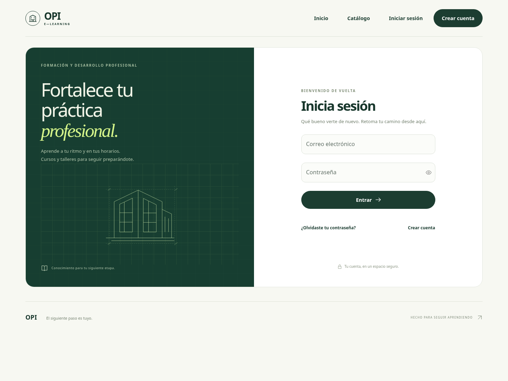
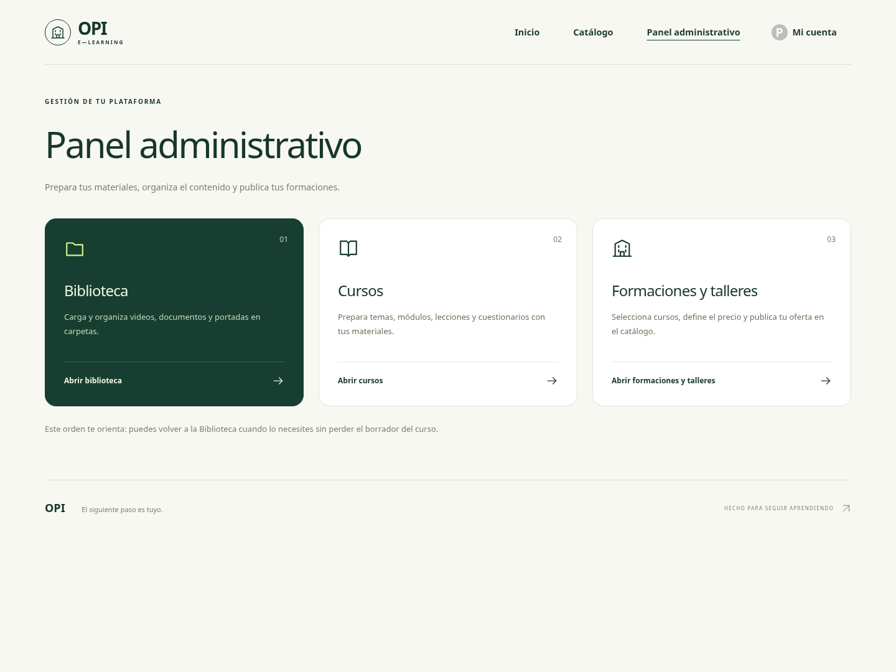
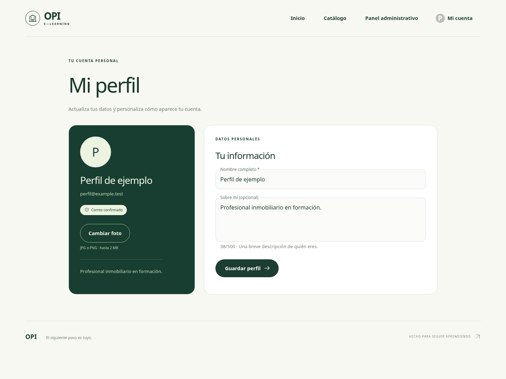
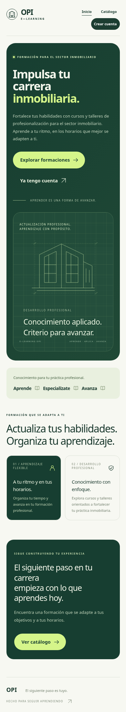

# Dirección visual — revisión de Fase 2

Paleta original conservada: verde profundo, fondo cálido y lima. Presentación
orientada a formación profesional inmobiliaria, componentes Material UI y tipografía
con jerarquía. La ilustración representa una construcción mediante trazos de plano.
Inicio incorpora un bloque principal verde, banda verde clara, tarjeta de beneficios
y cierre con acceso al catálogo. También vuelven las superficies verdes al perfil
y al panel. El plano se dibuja al entrar y un acento de luz lo recorre tres veces;
las secciones aparecen al desplazarse y mantienen transiciones de borde/sombra.
No hay estrellas, giros ni elementos flotando continuamente.
Se respeta prefers-reduced-motion.

## Inicio

## Acceso

## Panel administrativo

## Perfil personal

Las vistas de panel/perfil usan una sesión ilustrativa con respuestas API simuladas
(Perfil de ejemplo). Las pruebas con API y SQL reales se documentan por separado
en [la validación](phase2-validation.md).

## Móvil

Las capturas no contienen credenciales. El catálogo muestra únicamente formaciones
publicadas por administración; no hay estadísticas ni productos comerciales ficticios
precargados. Las pruebas de navegador crean contenido rotulado «de prueba».

Verificación de correo: crear cuenta → abrir enlace de confirmación → confirmar →
iniciar sesión. Token de una hora. En desarrollo el mensaje se guarda en .data/mail;
no se envía a una bandeja externa sin configurar SES.
