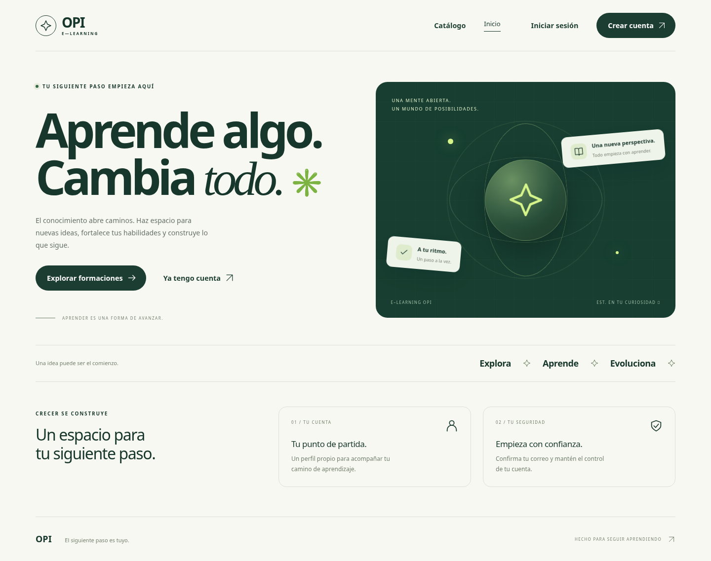

# Dirección visual — revisión

Rediseño editorial original: tipografía con más jerarquía, verde profundo y lima,
composición con profundidad, tarjetas y movimiento discreto. Material UI sigue
siendo la biblioteca base. Referencias de dirección: Awwwards y 21st.dev.

## Inicio

## Acceso

## Móvil

Las capturas no contienen credenciales. El catálogo muestra únicamente formaciones
publicadas por administración; no hay estadísticas ni productos comerciales ficticios
precargados. Las pruebas de navegador crean contenido de prueba claramente rotulado.

Verificación de correo: crear cuenta → abrir enlace de confirmación → confirmar →
iniciar sesión. Token de una hora. En desarrollo el mensaje se guarda en .data/mail;
no se envía a una bandeja externa sin configurar SES. El diseño no cambia esa regla.
