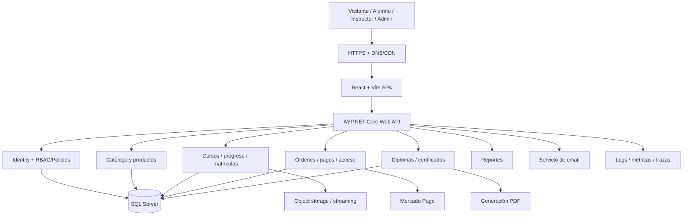
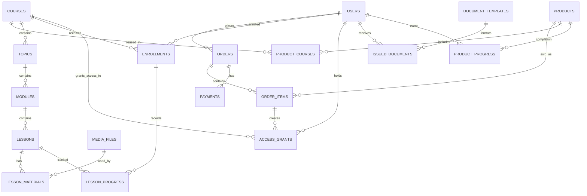
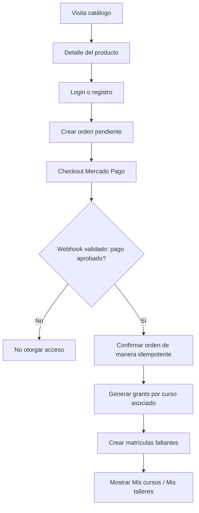
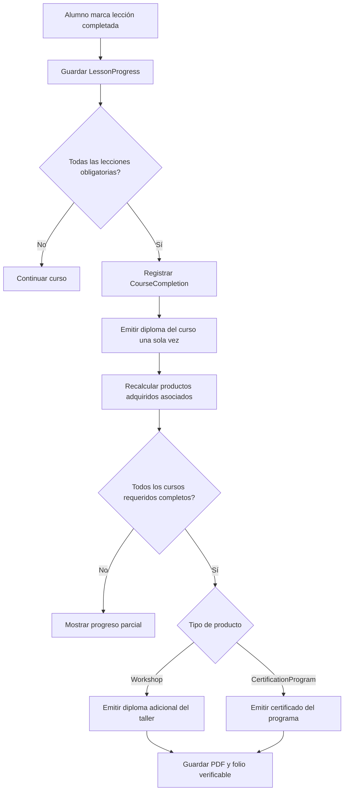

# Especificación técnica — Plataforma E-learning empresarial

**Archivo:** `specs.md`  
**Estado:** Especificación actualizada; reglas de talleres, videos, evaluaciones y administración confirmadas  
**Idioma del producto:** Español (México), preparado para internacionalización futura  
**Fecha:** 2026-11-09  
**Nombre provisional:** EduLearning (reemplazable por marca definitiva)

> **Instrucción a Codex:** Este documento es la fuente de verdad funcional inicial. Construir por fases, con código probado, migraciones, documentación y criterios de aceptación. No implementar características marcadas como futuras sin autorización. Ante ambigüedades, elegir la alternativa más sencilla y segura, documentar la decisión y solicitar confirmación antes de realizar cambios de producto significativos.

## 1. Resumen ejecutivo y objetivo

Crear una **plataforma LMS (Learning Management System) empresarial propia**, de una sola organización, accesible al público general. Los visitantes pueden explorar un catálogo, registrarse, comprar productos educativos individuales y estudiar desde su cuenta. El sistema ofrece videos, documentos, seguimiento de progreso, diplomas por curso y documentos finales por formación.

La referencia funcional y de experiencia de administración es ClassOnLive, especialmente las pantallas compartidas de gestión de formaciones, editor por pasos, temas/módulos/contenidos, biblioteca multimedia, usuarios, progreso, certificados, transacciones, estadísticas y configuración del sitio. **No copiar código, marcas ni diseños protegidos**; implementar una interfaz propia.

### 1.1 Alcance confirmado

- **Una sola empresa propietaria** de la plataforma; no vender ni alquilar espacios LMS a terceros.
- **Público general**: cualquier persona puede registrarse y comprar cursos.
- **Acceso de pago**: productos comprados individualmente, sin suscripción recurrente en el alcance inicial.
- **Tres tipos de productos comerciales**: curso individual, taller y formación con certificación.
- **Taller**: paquete de cursos individuales complementarios. **Una compra del taller otorga acceso inmediato a todos los cursos que lo integran.**
- **Documentación de talleres**: los cursos internos NO emiten diplomas individuales; al completar los cursos y sus cuestionarios se emite **un único certificado final del taller**, con promedio global.
- **Curso individual**: diploma al completar sus lecciones obligatorias.
- **Formación con certificación**: siempre se compone de uno o varios cursos; emitir únicamente el certificado final del programa al cumplir requisitos.
- **Contenido inicial**: videos, PDF y documentos/recursos descargables; cuestionarios obligatorios por cada curso dentro de talleres. Sin tareas ni exámenes independientes adicionales en MVP.
- **Sin drip content**: no hay desbloqueos por fecha ni tiempo. Una compra aprobada otorga derechos de acceso a todos los cursos del producto; dentro de un taller, el avance al siguiente curso está condicionado a finalizar los videos y aprobar el cuestionario con al menos 80/100 del curso anterior.
- **Documentos académicos PDF verificables** con folio único y página pública de validación.
- **Progreso único por usuario y curso**: si un curso aparece en varios productos, su progreso y diploma individual se reutilizan; no se duplican.
- **Un único administrador del sitio**, panel de alumno y sitio público. No existen cuentas ni panel de instructor.

### 1.2 Fuera del alcance inicial

- Multi-tenancy, creación o venta de academias/espacios, dominios por cliente, planes SaaS.
- Drip content y desbloqueos programados.
- Exámenes independientes y tareas. **Excepción obligatoria:** cuestionario calificado por cada curso de taller.
- Clases en vivo, webinars, foros, mensajería interna, blog, app móvil, IA generativa de cursos, automatizaciones de marketing.
- Suscripciones mensuales/anuales, marketplace de terceros, comisiones y gestión de instructores.
- Editor visual avanzado de páginas, CMS complejo, constructor HTML arbitrario de certificados.
- Reconocimiento oficial/acreditación de certificados: los documentos acreditan **finalización** y no competencia profesional ni validez oficial salvo acreditación real y comprobable.

### 1.3 Principios de diseño

1. Monolito modular primero; evitar microservicios prematuros.
2. Separar **lo que se vende** (`Product`) de **lo que se estudia** (`Course`).
3. Autorización y validación de pagos **siempre en backend**.
4. Reutilizar contenido sin duplicarlo.
5. Diseñar para extensión futura, sin sobreingeniería en MVP.
6. Código legible, probado, documentado, con interfaz accesible y responsive.

## 2. Roles, actores y permisos

| Actor | Capacidades principales |
|---|---|
| Visitante | Inicio, catálogo, búsqueda, filtros, detalle, temario público, registro/login, contacto, validación pública de folio. |
| Alumno | Perfil, carrito/checkout, historial de compras, cursos adquiridos, videos, documentos, progreso, diplomas/certificados, descarga de PDFs. |
| Administrador | Única persona operadora: CRUD y publicación de productos/cursos, usuarios, biblioteca, cuestionarios, plantillas, documentos, pedidos, pagos, cupones (fase posterior), reportes, sitio y ajustes. |

Usar ASP.NET Core Identity para identidad; roles y políticas de autorización. Solo roles `Admin` y `Student`; el sistema debe permitir exactamente una cuenta administrativa operativa, aprovisionada de forma segura. No crear módulos de instructor. No confiar en permisos del frontend.

## 3. Modelo funcional y terminología

- **Product**: oferta comercial del catálogo (título, slug, descripción de venta, portada, tipo, precio, moneda, publicación). Tipos: `IndividualCourse`, `Workshop`, `CertificationProgram`.
- **Course**: unidad académica reutilizable, independiente de cómo se compra. Contiene `Topics > Modules > Lessons` y materiales.
- **ProductCourse**: asociación ordenada entre producto y curso; `IsRequired` determina si se necesita para finalizar el producto.
- **Enrollment**: matrícula única del usuario en un curso, donde vive el progreso académico.
- **AccessGrant**: derecho de acceso a un curso derivado de una compra concreta (o concesión administrativa auditada). Puede haber varios grants para un mismo curso; se conserva una sola matrícula.
- **ProductProgress**: finalización agregada del taller/programa por usuario, calculada a partir de cursos requeridos.
- **Diploma**: documento de finalización de un curso comprado individualmente. Los cursos internos de un taller no generan diploma.
- **Certificate**: documento de finalización de un programa con certificación (no afirmar acreditación oficial).

### 3.1 Jerarquía académica

```text
Product (lo que se compra)
 ├── IndividualCourse -> Course
 ├── Workshop -> Course A, Course B, Course C...
 └── CertificationProgram -> Course A, Course B...

Course
 └── Topic (tema, orden)
      └── Module (módulo, orden)
           └── Lesson (lección, orden, obligatoria/opcional)
                ├── Video
                ├── PDF
                └── Archivos descargables
```

Un `Course` puede aparecer en varios `Products` y se almacena **una sola vez**. El editor de talleres debe seleccionar y ordenar cursos existentes, no duplicar lecciones.

### 3.2 Reglas de compra y acceso

1. El backend crea `Order` con `OrderItems`, precios y moneda **congelados al momento de compra**.
2. El frontend redirige a checkout del proveedor; no recopila datos sensibles de tarjeta.
3. La confirmación real llega mediante webhook verificado (firma, origen, estado consultado al proveedor cuando proceda), procesado idempotentemente.
4. Al marcar el pedido pagado, por cada producto comprado, generar `AccessGrants` para sus cursos asociados y crear `Enrollments` faltantes.
5. Los cursos exclusivos de talleres no se ofrecen como productos individuales. Conservar progreso si un curso académico se reutiliza entre productos adquiridos, sin duplicar matrícula ni emitir documentos de curso internos de taller.
6. Un curso solo es accesible si existe al menos un derecho de acceso **válido** y el usuario está autorizado. Un reembolso/revocación solo elimina el derecho asociado a esa compra, no otros derechos válidos.
7. La compra concede derechos de acceso inmediatos a todos los cursos incluidos, pero la interfaz y API bloquean iniciar el curso siguiente de un taller hasta completar los videos y el cuestionario del anterior; **no implementar drip temporal**.
8. Una compra de un taller se refleja tanto en **Mis talleres** (vista agrupada) como en **Mis cursos** (cursos individuales), evitando duplicados visuales de cursos.
9. Los productos pueden estar en borrador/publicados/archivados. Los cursos pueden estar en borrador/publicados/archivados; no mostrar contenido no publicado a alumnos.
10. Al cambiar la composición de un taller ya vendido, evitar revocaciones y cambios retroactivos inesperados: **versionar o congelar el conjunto de cursos/requisitos al momento de adquisición**, y documentar política de acceso a nuevo contenido. MVP: conservar snapshot de composición y reglas en `PurchaseEntitlements`/`ProductVersion`.

### 3.3 Reglas de finalización

- Una lección de video obligatoria se completa solo cuando el reproductor llega al final al menos una vez, aunque el alumno puede adelantar, retroceder y navegar libremente. El backend registra de forma idempotente el evento de finalización; no equivale a demostrar aprendizaje. Los documentos pueden marcarse consultados según regla específica.
- Un curso se completa cuando **todas sus lecciones obligatorias publicadas en la versión académica aplicable** están completas. Evitar que cambios posteriores invaliden diplomas emitidos.
- Emitir diploma por curso/version académica **solo si el curso fue comprado como producto individual**. Los cursos dentro de talleres no emiten diplomas individuales.
- Un taller se completa cuando todos sus cursos obligatorios tienen videos terminados y cuestionario aprobado (mejor nota >= 80/100). Emitir **solo un certificado final del taller**, con promedio de calificaciones de los cuestionarios de sus cursos; no diplomas por curso interno. Cada cuestionario requiere 80/100 y permite intentos ilimitados; cuenta la mejor nota.
- Una formación con certificación siempre agrupa cursos; emitir solo certificado final del programa al cumplir requisitos. No emitir diplomas por cursos internos por defecto.
- Si un curso pertenece a varios talleres, completar ese curso actualiza el progreso de todos los talleres adquiridos correspondientes.
- Emitir documentos idempotentemente; guardar snapshot de nombre del alumno, título, fecha, versión, emisor, plantilla y folio.
- Folio aleatorio/no secuencial público, único, verificable; página pública muestra información mínima (título, titular, fecha, estado) y no expone datos sensibles innecesarios.
- Estados del documento: `Issued`, `Revoked` (revocación auditada), y opcionalmente `PendingGeneration`/`GenerationFailed`.
- PDF generado asíncronamente cuando sea apropiado; reintentos controlados.

### 3.4 Casos de aceptación prioritarios

| Caso | Resultado esperado |
|---|---|
| Compra taller A (HTML, CSS, JS) | Una orden, acceso a los tres cursos, tres matrículas (si no existían). |
| Completa HTML | Diploma HTML, progreso de taller parcial. |
| Completa HTML+CSS+JS | Tres diplomas de curso + un diploma de taller (cuatro documentos). |
| Compra HTML y luego taller A | Una matrícula HTML, progreso conservado, derechos de acceso separados. |
| HTML incluido en talleres A y B comprados | Un progreso HTML y un diploma HTML; contribuye a ambos talleres. |
| Webhook de pago repetido | No duplica órdenes pagadas, grants, matrículas ni documentos. |
| Pago rechazado o pendiente | Sin acceso nuevo hasta confirmación válida. |
| Reembolso taller A, pero HTML comprado aparte | Se revocan grants del taller, HTML sigue accesible por su compra individual. |
| Alumno intenta abrir lección sin acceso | `403`/`404` según política; sin URL privada expuesta. |
| Alumno completa curso sin exámenes | Diploma de **finalización**, no de competencia evaluada. |

## 4. Arquitectura técnica

**Patrón:** monolito modular en capas / Clean Architecture pragmática, frontend SPA desacoplado, API REST, SQL Server, almacenamiento externo, integraciones de pago y correo.



### 4.1 Stack propuesto

| Capa | Elección |
|---|---|
| Frontend | React + Vite + **TypeScript** (recomendado, aunque ejemplos previos eran JSX) |
| Navegación | React Router |
| UI | HeroUI o Material UI; elegir **una** librería y documentar la decisión |
| Consultas | TanStack Query + Axios |
| Formularios | React Hook Form + Yup |
| Backend | C# + ASP.NET Core Web API (versión .NET LTS soportada al iniciar) |
| Persistencia | EF Core + SQL Server |
| Identidad | ASP.NET Core Identity + cookies HTTP-only seguras para SPA same-site, o access token corto y refresh token rotado; documentar elección y CSRF/CORS |
| Autorización | Roles + policies + permisos por recurso |
| Pagos | Mercado Pago para México; adaptador para cambiar a Stripe si se requiere |
| Videos | Cloudflare Stream o Mux, con reproducción protegida |
| Documentos/objetos | S3-compatible, p. ej. Cloudflare R2 o Amazon S3 |
| Correo | Proveedor transaccional configurable |
| PDF | Motor de plantillas y generador de PDF server-side |
| Trabajo asíncrono | `BackgroundService` + cola persistente / outbox; Hangfire opcional |
| Contenedores | Docker / Docker Compose para desarrollo |
| Calidad | xUnit, pruebas de integración, Vitest/Testing Library, Playwright opcional |

**No** almacenar videos o PDFs binarios en SQL Server; guardar metadatos y claves de almacenamiento. No exponer credenciales ni claves privadas en React.

### 4.2 Separación de responsabilidades

- **Domain:** entidades, enums, reglas e invariantes; sin dependencias de infraestructura.
- **Application:** casos de uso, DTOs, validadores, interfaces, orquestación, transacciones.
- **Infrastructure:** EF Core, Identity, pagos, almacenamiento, PDF, correo, colas.
- **API:** controladores/endpoints, auth, middleware, DI, validación de solicitudes y errores.
- **Frontend:** layouts, rutas, vistas, componentes reutilizables, servicios API, estado de servidor.

## 5. Esquema de datos propuesto

**Convenciones:** `Id` GUID/UUID o bigint consistente; `CreatedAtUtc`, `UpdatedAtUtc`, `RowVersion` donde aplique; índices, claves foráneas, restricciones `UNIQUE`; montos `decimal(18,2)` + `Currency` (MXN inicialmente). Guardar fechas en UTC. EF Core migrations versionadas.

### 5.1 Identidad y usuarios

- `Users` (ASP.NET Identity): `Id`, `FullName`, `Email`, `EmailConfirmed`, `Status`, `CreatedAtUtc`, etc. PasswordHash administrado por Identity.
- `Roles`, `UserRoles`, `UserClaims` y demás tablas de Identity.
- `InstructorAssignments`: `CourseId`, `UserId`, `AssignedAtUtc`, `Permissions` opcional. Clave única `(CourseId, UserId)`.
- `UserProfiles`: campos públicos/opcionales, preferencias y aceptación de avisos.

### 5.2 Catálogo y producto comercial

- `Categories`: `Id`, `Name`, `Slug`, `Description`, `IsActive`.
- `Products`: `Id`, `Type` (`IndividualCourse|Workshop|CertificationProgram`), `Title`, `Slug` único, `Summary`, `Description`, `CoverMediaId`, `CategoryId`, `Price`, `Currency`, `Status` (`Draft|Published|Archived`), `PublishedAtUtc`, `CreatedAtUtc`, `UpdatedAtUtc`.
- `Courses`: `Id`, `Title`, `Slug`, `Description`, `Status`, `EstimatedDurationMinutes`, `CreatedAtUtc`, `UpdatedAtUtc`.
- `ProductCourses`: `ProductId`, `CourseId`, `Position`, `IsRequired`; PK compuesta `(ProductId, CourseId)`; al menos un curso por producto publicado; `IndividualCourse` debe asociar exactamente un curso.
- `ProductVersions` / `ProductVersionCourses`: snapshot de composición y requisitos aplicables a una compra; decidir esquema concreto antes de habilitar cambios en productos publicados.
- `ProductMedia` o `CoverMediaId`: portada e imágenes para página de venta.

### 5.3 Contenido educativo

- `Topics`: `Id`, `CourseId`, `Title`, `Position`.
- `Modules`: `Id`, `TopicId`, `Title`, `Description`, `Position`.
- `Lessons`: `Id`, `ModuleId`, `Title`, `Description`, `LessonType` (`Video|Document|Mixed`), `Position`, `IsRequired`, `Status`, `EstimatedDurationMinutes`.
- `MediaFiles`: `Id`, `StorageProvider`, `StorageKey`, `OriginalFileName`, `MimeType`, `SizeBytes`, `ProcessingStatus`, `CreatedByUserId`, `CreatedAtUtc`.
- `LessonMaterials`: `LessonId`, `MediaFileId`, `Kind` (`Video|Pdf|Download`), `Position`, `IsDownloadable`.
- `MediaFolders` (fase de biblioteca): carpetas lógicas, permisos administrativos, metadatos.

### 5.4 Comercio, pagos y derechos de acceso

- `Orders`: `Id`, `UserId`, `Status` (`Pending|Paid|Failed|Cancelled|Refunded|PartiallyRefunded`), `Subtotal`, `Discount`, `Total`, `Currency`, `CreatedAtUtc`, `PaidAtUtc`.
- `OrderItems`: `Id`, `OrderId`, `ProductId`, `ProductVersionId`, `ProductTitleSnapshot`, `UnitPrice`, `Currency`, `Quantity` (MVP 1 por producto), `DiscountAmount`.
- `Payments`: `Id`, `OrderId`, `Provider`, `ProviderPaymentId`, `Status`, `Amount`, `Currency`, `PaidAtUtc`, `RawMetadataReference`; índice único por proveedor + id externo.
- `PaymentWebhookEvents`: `Provider`, `EventId`, `ReceivedAtUtc`, `ProcessedAtUtc`, `ProcessingStatus`, `PayloadHash`; clave única para idempotencia.
- `AccessGrants`: `Id`, `UserId`, `CourseId`, `OrderItemId` nullable, `SourceType` (`Purchase|Admin`), `Status` (`Active|Revoked`), `GrantedAtUtc`, `RevokedAtUtc`; permitir múltiples grants válidos por usuario/curso de distintas fuentes, evitar duplicar mismo origen.
- `Enrollments`: `Id`, `UserId`, `CourseId`, `Status`, `EnrolledAtUtc`, `CompletedAtUtc`; `UNIQUE(UserId, CourseId)`.
- `Coupons` / `CouponRedemptions`: **fase posterior**; interfaz administrativa opcional sin lógica en MVP.
- Facturación fiscal CFDI: **integración posterior** con PAC autorizado en México; no confundir recibo PDF con factura fiscal.

### 5.5 Progreso y documentos

- `LessonProgress`: `EnrollmentId`, `LessonId`, `IsCompleted`, `CompletedAtUtc`, `LastPositionSeconds` opcional; `UNIQUE(EnrollmentId, LessonId)`.
- `CourseCompletions`: `Id`, `UserId`, `CourseId`, `AcademicVersion`, `CompletedAtUtc`; unicidad por usuario/curso/versión aplicable.
- `ProductProgress`: `Id`, `UserId`, `ProductId`, `ProductVersionId`, `CompletedAtUtc`, `Status`; unicidad por usuario/producto/versión adquirida conforme política definida.
- `CompletionRules`: `Id`, `ProductId`, `ProductVersionId`, `RuleType` (`AllRequiredCourses`), `ConfigurationJson` validado.
- `DocumentTemplates`: `Id`, `Name`, `DocumentType` (`CourseDiploma|WorkshopDiploma|ProgramCertificate`), `BackgroundMediaId`, `StyleJson`, `IsActive`, `Version`.
- `TemplateAssets`: `Id`, `TemplateId`, `MediaFileId`, `Role` (`Logo|Signature|Seal|Background`).
- `IssuedDocuments`: `Id`, `UserId`, `DocumentType`, `CourseId` nullable, `ProductId` nullable, `ProductVersionId` nullable, `TemplateId`, `TemplateVersion`, `VerificationCode` único, `IssuedAtUtc`, `Status`, `PdfStorageKey`, `RecipientNameSnapshot`, `TitleSnapshot`, `IssuerSnapshot`, `RevokedAtUtc`, `RevocationReason`; restricción para que corresponda a curso **o** producto, según tipo.
- `AuditLogs`: `Id`, `ActorUserId`, `Action`, `EntityType`, `EntityId`, `TimestampUtc`, `MetadataJson` sin datos sensibles.

**Simplificación recomendada:** utilizar una sola tabla `IssuedDocuments` para diplomas y certificados, en lugar de tablas separadas `CourseDiplomas` y `ProductDocuments`. El tipo y la entidad de origen determinan la clase de documento. Mantener la lógica de emisión en servicios diferenciados.

### 5.6 Relaciones y restricciones esenciales



**Nota:** la pertenencia de cursos a productos, la versión académica y los derechos de acceso deben evaluarse en backend; las claves foráneas por sí solas no resuelven el control de acceso.

## 6. Flujos de negocio

### 6.1 Crear y publicar formación (admin)

1. Seleccionar tipo: curso individual / taller / certificación.
2. **Información:** título, categoría, descripción, objetivos, requisitos, duración estimada.
3. **Detalles:** instructor(es), metadatos y configuración académica.
4. **Temas y contenidos:** para curso, crear temas > módulos > lecciones y asociar videos/PDF; para taller/programa, seleccionar y ordenar cursos existentes y marcar obligatorios.
5. **Precio:** precio y moneda MXN.
6. **Diseño:** portada, descripción de venta, vista previa del catálogo y página de detalle.
7. **Activar:** validar requisitos mínimos y publicar.

**Se elimina el paso `Drip`** de la referencia ClassOnLive. No generar campos, endpoints, jobs ni UI para liberación programada.

Funciones administrativas: listar, buscar, filtrar por tipo/creador/instructor/estado/visibilidad, editar, duplicar como borrador, activar/desactivar, vista previa y reordenar temas/módulos/lecciones (drag-and-drop con persistencia de `Position`).

### 6.2 Comprar curso o taller



### 6.3 Completar y emitir documentos



### 6.4 Gestión de medios

Admin/instructor autorizado solicita carga -> API valida tipo/tamaño/permisos -> URL de subida segura o carga mediada -> objeto privado en storage/streaming -> procesamiento y metadatos -> vinculación a lección -> alumno autorizado obtiene acceso temporal. Nunca confiar en un `StorageKey` suministrado por alumno sin comprobar permisos.

## 7. API REST propuesta (v1)

**Prefijo:** `/api/v1`. JSON, errores estandarizados `ProblemDetails`, paginación `page/pageSize`, filtros, ordenación, validación y códigos HTTP apropiados. Swagger/OpenAPI en desarrollo. No permitir escalamiento de roles desde endpoints de registro.

### 7.1 Auth y perfil

| Método | Ruta | Permiso | Función |
|---|---|---|---|
| POST | `/auth/register` | Público | Registro alumno |
| POST | `/auth/login` | Público | Inicio de sesión |
| POST | `/auth/logout` | Autenticado | Cerrar sesión |
| POST | `/auth/refresh` | Según estrategia | Renovación segura |
| POST | `/auth/forgot-password` | Público | Solicitar recuperación |
| POST | `/auth/reset-password` | Público/token | Restablecer contraseña |
| POST | `/auth/confirm-email` | Token | Confirmar correo |
| GET | `/users/me` | Autenticado | Perfil |
| PATCH | `/users/me` | Autenticado | Editar perfil |

### 7.2 Catálogo público

| Método | Ruta | Función |
|---|---|---|
| GET | `/products` | Listado público con `type`, `category`, `search`, `sort`, paginación |
| GET | `/products/{slug}` | Detalle, precio, temario público, cursos incluidos |
| GET | `/categories` | Categorías activas |
| GET | `/certificates/verify/{code}` | Validar folio y estado sin exponer información privada |

### 7.3 Administración de productos y contenido

| Método | Ruta | Función |
|---|---|---|
| GET/POST | `/admin/products` | Listar/crear productos |
| GET/PUT | `/admin/products/{id}` | Detalle/editar |
| POST | `/admin/products/{id}/publish` | Publicar tras validación |
| POST | `/admin/products/{id}/unpublish` | Despublicar |
| POST | `/admin/products/{id}/duplicate` | Duplicar como borrador |
| PUT | `/admin/products/{id}/courses` | Asociar/ordenar cursos del producto |
| GET/POST | `/admin/courses` | Listar/crear cursos |
| GET/PUT | `/admin/courses/{id}` | Consultar/editar curso |
| POST | `/admin/courses/{id}/topics` | Crear tema |
| PUT/DELETE | `/admin/topics/{id}` | Editar/eliminar tema (con reglas de integridad) |
| POST | `/admin/topics/{id}/modules` | Crear módulo |
| PUT/DELETE | `/admin/modules/{id}` | Editar/eliminar módulo |
| POST | `/admin/modules/{id}/lessons` | Crear lección |
| PUT/DELETE | `/admin/lessons/{id}` | Editar/eliminar lección |
| PUT | `/admin/courses/{id}/structure/order` | Reordenar estructura |
| GET/POST | `/admin/media` | Listar/registrar archivos |
| POST | `/admin/media/upload-intents` | Obtener carga segura |
| GET/POST | `/admin/document-templates` | Listar/crear plantillas |
| PUT | `/admin/document-templates/{id}` | Editar plantilla |
| GET | `/admin/issued-documents` | Documentos emitidos |
| POST | `/admin/issued-documents/{id}/revoke` | Revocar con motivo y auditoría |
| GET | `/admin/users` | Buscar y filtrar usuarios |
| GET | `/admin/orders` | Listar pedidos |
| GET | `/admin/payments` | Consultar pagos |
| GET | `/admin/reports/overview` | KPIs generales |
| GET | `/admin/reports/progress` | Reporte de progreso |

Los instructores deben tener rutas/policies propias o compartir endpoints con autorización por recurso; **no** concederles acceso administrativo global por reutilizar rutas.

### 7.4 Compra y alumno

| Método | Ruta | Función |
|---|---|---|
| POST | `/orders` | Crear orden con productos y precio validado en servidor |
| GET | `/orders/mine` | Historial del alumno |
| POST | `/payments/checkout` | Crear sesión/preferencia de pago para orden válida |
| POST | `/webhooks/mercadopago` | Webhook externo verificado, idempotente |
| GET | `/student/products` | Productos comprados, agrupados |
| GET | `/student/courses` | Cursos accesibles sin duplicados |
| GET | `/student/courses/{courseId}` | Estructura de curso autorizada |
| GET | `/student/lessons/{lessonId}` | Lección y recursos autorizados |
| POST | `/student/lessons/{lessonId}/complete` | Completar lección idempotentemente |
| GET | `/student/courses/{courseId}/progress` | Progreso de curso |
| GET | `/student/products/{productId}/progress` | Progreso de taller/programa |
| GET | `/student/documents` | Mis diplomas y certificados |
| GET | `/student/documents/{id}/download` | URL temporal o descarga autenticada |
| GET | `/student/media/{mediaId}/access` | Acceso temporal a recurso autorizado |

### 7.5 Contratos mínimos de ejemplo

```json
{
  "createProduct": {
    "type": "Workshop",
    "title": "Taller de Desarrollo Web",
    "price": 1200.00,
    "currency": "MXN",
    "courses": [
      {"courseId": "course-html", "position": 1, "isRequired": true},
      {"courseId": "course-css", "position": 2, "isRequired": true},
      {"courseId": "course-js", "position": 3, "isRequired": true}
    ]
  }
}
```

Los identificadores anteriores son ilustrativos. El backend define los IDs reales. Nunca aceptar precios enviados por el cliente como autoridad para cobrar.

## 8. Pantallas y componentes clave (React)

### 8.1 Sitio público

- `/`: Home (propuesta de valor, cursos destacados, categorías, CTA).
- `/catalogo`: catálogo con búsqueda, filtros por categoría/tipo y ordenación.
- `/formacion/:slug`: detalle del producto, portada, descripción, temario, cursos incluidos, instructor, precio y CTA de compra.
- `/nosotros`, `/contacto`, `/terminos`, `/privacidad`.
- `/login`, `/registro`, `/recuperar-contrasena`.
- `/verificar-certificado/:code`: consulta pública de folio.
- `/checkout/resultado`: mostrar estado informativo, **nunca otorgar acceso desde esta página**.

### 8.2 Alumno

- `/alumno/dashboard`: resumen, continuar aprendiendo.
- `/alumno/mis-formaciones`: productos comprados (talleres/certificaciones/cursos).
- `/alumno/mis-cursos`: cursos accesibles únicos, progreso.
- `/alumno/cursos/:id`: reproductor de video, navegación por temas/módulos/lecciones, PDF, descarga, botón completar.
- `/alumno/documentos`: diplomas y certificados con descarga y verificación.
- `/alumno/compras`: historial y estados.
- `/alumno/perfil`: datos y seguridad.

### 8.3 Administración

- `/admin`: dashboard KPIs (visitas, registros, alumnos activos, ventas, productos populares; implementar medición real antes de mostrar cifras).
- `/admin/formaciones`: tabla con búsqueda/filtros tipo, creador, instructor, estado, visibilidad, acciones.
- `/admin/formaciones/nueva`: asistente por pasos **sin drip**.
- `/admin/formaciones/:id/editar`: edición y vista previa.
- `/admin/cursos`: CRUD de contenido reutilizable.
- `/admin/biblioteca`: carpetas, archivos, filtros, permisos de edición.
- `/admin/usuarios`: alumnos, instructores, estado, inscripciones.
- `/admin/progreso`: avance por curso/taller y alumno.
- `/admin/documentos`: plantillas, logos/firmas, documentos emitidos.
- `/admin/ventas`: órdenes, transacciones, filtros y estados.
- `/admin/configuracion`: logo, favicon, datos de empresa, pagos, emails, privacidad.

### 8.4 Componentes reutilizables

`AppShell`, `Sidebar`, `Topbar`, `ProtectedRoute`, `RoleGate`, `CourseCard`, `ProductCard`, `ProductTypeBadge`, `ProductFilters`, `CourseOutline`, `TopicEditor`, `ModuleEditor`, `LessonEditor`, `SortableList`, `MediaPicker`, `VideoPlayer`, `DocumentViewer`, `ProgressBar`, `PurchaseButton`, `CheckoutStatus`, `CertificatePreview`, `CertificateTemplateEditor`, `DataTable`, `ConfirmDialog`, `EmptyState`, `ErrorBoundary`, `LoadingSkeleton`, `Pagination`.

### 8.5 Editor de diplomas/certificados

Inspirado en las capturas: nombre de empresa, identificador de plantilla, colores de fondo/texto/borde, título, texto adicional, logo(s), firma(s), vista previa y PDF final. En MVP usar **plantillas predefinidas configurables** o imagen de fondo segura; editor HTML arbitrario queda fuera por riesgos de seguridad y complejidad. Los datos emitidos deben quedar congelados aunque cambie una plantilla.

## 9. Estructura de archivos propuesta

```text
EduLearning/
├── specs.md
├── README.md
├── .editorconfig
├── .gitignore
├── .env.example                  # sin secretos reales
├── docker-compose.yml
├── docs/
│   ├── architecture.md
│   ├── decisions/                 # ADRs
│   ├── api.md
│   ├── database.md
│   └── deployment.md
├── frontend/
│   ├── package.json
│   ├── vite.config.ts
│   ├── tsconfig.json
│   ├── src/
│   │   ├── app/                  # router, providers, bootstrap
│   │   ├── assets/
│   │   ├── components/
│   │   │   ├── ui/
│   │   │   ├── courses/
│   │   │   ├── products/
│   │   │   ├── media/
│   │   │   └── certificates/
│   │   ├── layouts/
│   │   │   ├── PublicLayout.tsx
│   │   │   ├── StudentLayout.tsx
│   │   │   ├── InstructorLayout.tsx
│   │   │   └── AdminLayout.tsx
│   │   ├── pages/
│   │   │   ├── public/
│   │   │   ├── auth/
│   │   │   ├── student/
│   │   │   ├── instructor/
│   │   │   └── admin/
│   │   ├── features/
│   │   │   ├── auth/
│   │   │   ├── catalog/
│   │   │   ├── courses/
│   │   │   ├── products/
│   │   │   ├── checkout/
│   │   │   ├── progress/
│   │   │   └── credentials/
│   │   ├── hooks/
│   │   ├── services/             # Axios, endpoints tipados
│   │   ├── schemas/              # Yup
│   │   ├── types/
│   │   └── styles/
│   └── tests/
├── backend/
│   ├── EduLearning.sln
│   ├── src/
│   │   ├── EduLearning.API/
│   │   │   ├── Controllers/
│   │   │   ├── Middleware/
│   │   │   ├── Authorization/
│   │   │   └── Program.cs
│   │   ├── EduLearning.Application/
│   │   │   ├── Auth/
│   │   │   ├── Catalog/
│   │   │   ├── Courses/
│   │   │   ├── Commerce/
│   │   │   ├── Progress/
│   │   │   ├── Credentials/
│   │   │   ├── Media/
│   │   │   └── Common/
│   │   ├── EduLearning.Domain/
│   │   │   ├── Entities/
│   │   │   ├── Enums/
│   │   │   ├── Events/
│   │   │   └── Rules/
│   │   └── EduLearning.Infrastructure/
│   │       ├── Persistence/
│   │       │   ├── Configurations/
│   │       │   └── Migrations/
│   │       ├── Identity/
│   │       ├── Payments/
│   │       ├── Storage/
│   │       ├── Pdf/
│   │       ├── Email/
│   │       └── BackgroundJobs/
│   └── tests/
│       ├── EduLearning.UnitTests/
│       └── EduLearning.IntegrationTests/
└── scripts/
    ├── dev-setup.md
    └── seed-demo-data.md
```

La estructura es propuesta, no mandato de crear carpetas vacías. Organizar el código por módulos funcionales dentro de las capas; no duplicar lógica en `Services` genéricos.

## 10. Seguridad, privacidad y cumplimiento

- HTTPS en producción; secretos en variables de entorno/secret manager; `.env.example` sin credenciales.
- Identity con hash de contraseña seguro, confirmación de email, recuperación con tokens de expiración corta, rate limiting y bloqueo ante abuso.
- Sesiones seguras (cookies `HttpOnly`, `Secure`, `SameSite` y CSRF si se usan cookies; o tokens con rotación segura y almacenamiento apropiado). CORS limitado a orígenes permitidos.
- RBAC + autorización por recurso en todos los endpoints de instructor/alumno/admin.
- Archivos privados y streaming con enlaces temporales o tokens; nunca exponer buckets públicos para contenido de pago.
- Validación server-side de tamaño, tipo MIME real, extensiones, nombres y escaneo cuando corresponda; impedir path traversal.
- Pagos: firma de webhook, idempotencia, comprobación de montos y moneda, estados consistentes, transacciones atómicas, no almacenar datos de tarjeta.
- Auditoría de emisión/revocación de documentos, pagos, cambios de precio, cambios de roles y acceso administrativo.
- Minimizar datos personales, publicar aviso de privacidad, términos, política de reembolsos y consentimiento para comunicaciones comerciales; revisar LFPDPPP aplicable en México con asesoría legal.
- Facturación CFDI, IVA, impuestos y obligaciones fiscales: definir con contador/PAC antes de ofrecer facturación fiscal.
- No afirmar que un certificado tiene reconocimiento oficial si no existe.
- Respaldos automatizados de base de datos, restauración probada, monitoreo, alertas y registros sin secretos.
- Accesibilidad: navegación por teclado, contraste, subtítulos para videos cuando estén disponibles, texto alternativo, estados de error claros, responsive; apuntar a WCAG 2.2 AA.

## 11. Observabilidad, métricas y reportes

KPIs inspirados en capturas de ClassOnLive:

- Visitas al sitio y páginas de producto (requiere analítica y política de privacidad).
- Registros nuevos, alumnos activos, cursos/talleres más vistos.
- Órdenes pagadas, ingresos por periodo, reembolsos.
- Inscripciones por producto/curso, porcentaje de avance, finalizaciones.
- Diplomas/certificados emitidos.

Definir fórmulas antes de mostrar métricas; por ejemplo, `Ventas = suma de órdenes pagadas menos reembolsos` con criterio fiscal/contable documentado. No inventar datos en dashboard.

## 12. Estrategia de pruebas y calidad

### Unitarias

- Reglas `AllRequiredLessonsCompleted`, `AllRequiredCoursesCompleted`.
- Reutilización de progreso, generación idempotente de documentos.
- Cálculo de precios y totales con decimal.
- Autorización por recurso y validaciones de publicación.

### Integración

- EF Core + SQL Server de prueba, constraints e índices.
- Flujo de pago con webhook repetido, fuera de orden, fallido y reembolso.
- Concesión/revocación de grants, sin pérdida de acceso por otra compra.
- Protección de medios y endpoints de alumno.
- Concurrencia: dos webhooks o dos completados simultáneos no duplican registros.

### E2E

1. Visitante explora y compra un curso (pasarela sandbox).
2. Alumno estudia y obtiene diploma.
3. Alumno compra taller y accede a todos sus cursos.
4. Completa taller y obtiene diplomas de cursos + diploma adicional.
5. Admin crea, edita, previsualiza y publica formación.
6. Alumno no autorizado no puede acceder a contenido premium.

## 13. Fases de implementación y entregables

### Fase 0 — Preparación y decisiones

- Crear repositorio, `README`, `specs.md`, ADRs, convenciones, CI básica.
- Elegir .NET LTS, librería UI, estrategia auth, proveedor de pagos y storage.
- Aclarar pendientes de producto (sección 15).
- Configurar Docker Compose y variables de entorno de desarrollo.

**Salida:** solución ejecutable en local, documentación de arranque.

### Fase 1 — Fundamentos e identidad

- Solución .NET por capas, React+TS, SQL Server, EF migrations.
- Identity, registro/login, roles, perfil, protección de rutas.
- Seed de administrador de desarrollo (credenciales no hardcodeadas).

**Aceptación:** registro, login, roles y endpoints protegidos con tests.

### Fase 2 — Catálogo, cursos y administración

- Entidades `Products`, `Courses`, `ProductCourses`, categorías, temas, módulos, lecciones.
- CRUD admin, selección de cursos para talleres, asistente por pasos **sin drip**.
- Catálogo público, detalle, filtros, estado de publicación.
- Biblioteca multimedia básica, subida segura y reproducción protegida.

**Aceptación:** crear curso HTML y taller que lo incluya sin duplicar curso.

### Fase 3 — Comercio y acceso

- Órdenes, items, pasarela sandbox, webhook validado, grants, matrículas.
- Panel de compras, mis formaciones y mis cursos.
- Reembolsos/revocación con conservación de otros grants válidos.

**Aceptación:** compra de taller habilita todos sus cursos; webhooks duplicados no duplican matrículas.

### Fase 4 — Experiencia académica y progreso

- Reproductor, PDF/descargas, estructura del curso, completar lección.
- Progreso de curso y taller, continuidad entre productos.
- Control de acceso a contenido por matrícula/grant.

**Aceptación:** HTML conserva progreso aunque sea comprado solo y como parte de taller.

### Fase 5 — Diplomas y certificados

- Plantillas configurables, generación PDF, folio verificable, Mis documentos.
- Reglas de diploma individual y diploma adicional de taller.
- Certificado de finalización de programa.
- Idempotencia y auditoría.

**Aceptación:** taller de tres cursos completados produce exactamente cuatro documentos (3 + 1).

### Fase 6 — Dashboard, robustez y despliegue

- KPIs reales, filtros, reportes, correos transaccionales, auditoría.
- Seguridad, accesibilidad, rendimiento, backups, CI/CD, producción.
- Documentación operativa, pruebas de restauración, checklist de lanzamiento.

**Aceptación:** despliegue reproducible, flujos críticos probados y monitoreados.

### Fase posterior opcional (no implementar automáticamente)

Cupones, carrito multi-producto sofisticado, facturación CFDI/PAC, marketing, interesados/leads, foros, blog, mensajería, clases en vivo, evaluaciones, certificados acreditados, apps móviles, editor avanzado de páginas, analítica enriquecida.

## 14. Instrucciones de ejecución para Codex

1. **Leer este documento completo** antes de crear archivos.
2. Empezar por **Fase 0**; proponer plan de tareas y ADRs de decisiones pendientes.
3. Implementar **una fase a la vez** y solicitar revisión del usuario al concluir cada fase.
4. Antes de cambios grandes, explicar archivos que se crearán/modificarán y las migraciones.
5. Mantener tests relevantes junto a cada feature, ejecutar build/lint/tests y reportar resultados reales.
6. No inventar credenciales, claves de API, dominios, precios reales, logotipos ni información legal/fiscal.
7. Proveer adaptadores `FakePaymentGateway`, `LocalMediaStorage` y `FakeEmailSender` **solo para desarrollo** si todavía no hay credenciales; impedir su uso accidental en producción.
8. Mantener datos semilla de demostración claramente identificados como ficticios.
9. No implementar Multi-Tenant ni drip content bajo ninguna circunstancia salvo nuevo requerimiento explícito.
10. En dudas funcionales, no suponer reglas de negocio nuevas: marcar como pendiente y preguntar.
11. Priorizar transacciones, idempotencia, acceso seguro a contenido y unicidad de diplomas sobre pulido visual prematuro.
12. No copiar el diseño exacto ni recursos de ClassOnLive; utilizarlo únicamente como referencia funcional.

## 15. Decisiones confirmadas y pendientes

### 15.1 Confirmadas (prioridad sobre cualquier texto heredado contradictorio)

1. **Talleres:** un único producto de compra; sus cursos internos no se venden por separado y **no** generan diplomas individuales. Se emite **un solo certificado final del taller**.
2. **Cuestionarios de taller:** cada curso interno tiene un cuestionario obligatorio. Su calificación aporta al promedio final del taller. Se conserva la calificación por curso y el promedio en el certificado final.
3. **Avance secuencial en talleres:** el alumno puede navegar libremente por el video, incluso adelantarlo, pero solo se completa si llegó al final al menos una vez. Para pasar al **siguiente curso** debe completar todos los videos obligatorios y aprobar el cuestionario con al menos 80/100 del curso actual. Los documentos no bloquean por sí solos salvo decisión posterior.
4. **Sin drip:** no desbloquear por fecha, calendario ni días desde la compra. Distinguir bloqueo por prerrequisitos académicos de bloqueo temporal.
5. **Talleres congelados:** cada compra referencia una versión/snapshot inmutable de cursos, orden y requisitos; una eventual modificación futura no altera lo adquirido por compradores anteriores.
6. **Certificaciones:** programas siempre compuestos por cursos; emiten solo certificado final, no diplomas individuales por sus cursos internos.
7. **Administrador:** una sola persona gestiona todo el sitio. No crear rol, panel, CRUD, asignación ni endpoints de instructor.
8. **Acceso:** indefinido mientras cuenta/producto estén vigentes y sujeto a términos publicados (default provisional).
9. **Pagos:** primera integración Mercado Pago, moneda MXN.
10. **Carrito:** soportar múltiples `OrderItems` en el modelo; UI de checkout inicial sencilla.

### 15.2 Pendientes (no inventar respuestas)

- **Calificación de cuestionarios:** escala (recomendado 0–100), ponderación entre cursos (recomendado promedio aritmético simple), intentos permitidos, qué intento cuenta, umbral mínimo para aprobar y si basta responder para avanzar. **CONFIRMADO: calificación mínima 80/100, intentos ilimitados y mejor nota conservada.** Para MVP se puede almacenar calificación y marcar cuestionario como respondido; el avance requiere respuesta completa, no nota mínima, hasta que el negocio decida.
- **Certificaciones independientes:** criterio específico de finalización y si incorporarán cuestionarios (no trasladar automáticamente la regla de talleres).
- **Plantillas:** identidad corporativa, firmas, textos, logos, revocación y aspecto de diploma/certificado.
- **Mercado Pago:** métodos habilitados, reembolsos, contracargos y conciliación.
- **Facturación mexicana:** CFDI/PAC desde lanzamiento o fase posterior.
- **Versionado de cursos:** política de equivalencia de lecciones y progreso ante cambios de contenido publicado, manteniendo snapshots de compras.
- **Marca y legal:** nombre, dominio, identidad visual, términos, privacidad y datos de empresa.

## 16. Definición de terminado del MVP

El MVP estará terminado cuando, en entorno de pruebas:

- [ ] Un administrador crea un curso con temas, módulos, videos y PDF.
- [ ] Puede crear un taller con varios cursos existentes, sin duplicarlos.
- [ ] Puede crear una formación con certificación.
- [ ] Publica productos con precio y página de detalle.
- [ ] Un visitante se registra e inicia sesión.
- [ ] Compra un curso o taller con pago de prueba confirmado en backend.
- [ ] Obtiene acceso inmediato a todo el contenido incluido.
- [ ] El alumno visualiza y descarga materiales autorizados.
- [ ] El video se completa al llegar al final una vez; adelantar y retroceder está permitido; la finalización persiste en backend.
- [ ] Cada curso de taller exige cuestionario aprobado (mejor nota >= 80/100) y calificado para avanzar al siguiente; el promedio final se calcula con las calificaciones de los cursos.
- [ ] Un curso comprado individualmente genera un diploma al completarse.
- [ ] Los cursos internos de talleres no se venden por separado ni emiten diplomas.
- [ ] Un taller completado genera exactamente un certificado final con promedio.
- [ ] Una formación con certificación agrupa cursos y genera únicamente certificado final.
- [ ] Solo hay un administrador operativo; no existen rutas, roles ni paneles de instructores.
- [ ] Una compra de taller mantiene inmutable la composición adquirida.
- [ ] Los documentos se descargan en PDF y verifican por folio público.
- [ ] No hay drip content, Multi-Tenant ni funciones fuera del alcance.
- [ ] Los permisos, webhooks, reembolsos y duplicados están probados.
- [ ] Hay instrucciones de desarrollo, migraciones, pruebas y despliegue.

---

**Nota final:** Este documento consolida los requisitos discutidos y las propuestas técnicas. Las pantallas de ClassOnLive se utilizaron para identificar capacidades, no para inferir su implementación interna. La arquitectura resultante es una propuesta independiente y propia para la empresa.


## 17. Contratos de implementación para cuestionarios, videos y certificados (actualización obligatoria)

### 17.1 Entidades adicionales / ajustes

- `CourseQuizzes(Id, CourseId, VersionId, Title, IsRequired, Status)`: un cuestionario obligatorio por curso cuando se usa dentro de un taller (puede asociarse mediante versión de curso/producto si requiere cuestionarios diferentes según taller).
- `QuizQuestions(Id, QuizId, Prompt, Type, Position, Points)`: en MVP preferir opción múltiple autocorregible; evitar almacenar respuestas correctas en payload público.
- `QuizOptions(Id, QuestionId, Text, IsCorrect, Position)`: `IsCorrect` solo accesible en backend/admin.
- `QuizAttempts(Id, QuizId, EnrollmentId, StartedAt, SubmittedAt, Score, MaxScore, Status)`: registrar intentos, resultado y fecha; no sobrescribir historial.
- `QuizResponses(Id, AttemptId, QuestionId, SelectedOptionId, AwardedPoints)`: respuestas por intento.
- `VideoProgress(Id, EnrollmentId, LessonId, HasReachedEnd, FirstReachedEndAt, LastPositionSeconds, UpdatedAt)`: finalización idempotente, una vez verdadera no revierte.
- `ProductVersions(Id, ProductId, VersionNumber, PublishedAt, SnapshotJson)`, `PurchaseEntitlements(Id, OrderItemId, ProductVersionId, UserId)`: preservar composición y requisitos adquiridos.
- `ProductProgress`: añadir `FinalAverage`, `CompletedAt`, `ProductVersionId`.
- `IssuedDocuments`: preferir tabla única con `DocumentType` (`IndividualCourseDiploma`, `WorkshopCertificate`, `CertificationProgramCertificate`), `ProductVersionId`, `FinalAverage` opcional, snapshot de datos, estado y folio único. Si se mantienen tablas `CourseDiplomas`/`ProductDocuments`, aplicar estas mismas restricciones semánticas.
- `Products`: `Type` (`IndividualCourse`, `Workshop`, `CertificationProgram`), `Currency=MXN`; los cursos internos de taller no generan automáticamente un `IndividualCourse` vendible. Validar esta restricción también en backend al publicar.

**Invariantes de datos:** índices únicos por usuario/curso para matrícula, por compra/curso para grants, por alumno/producto-versión/tipo para certificado final, y por alumno/curso-versión para diploma individual. `OrderItems` almacena precio y moneda congelados. En taller, conservar orden de cursos y versión adquirida.

### 17.2 Reglas del reproductor

- El alumno puede hacer `seek`, pausar, repetir y adelantar a cualquier punto del video.
- Un video se completa solo tras observar el evento de fin de reproducción (`ended` o equivalente verificado por integración), **incluso si adelantó casi todo el video**. No requerir 80%, 90% ni visualización continua.
- React envía evento de finalización; backend comprueba identidad, acceso al curso, lección válida y autorización, registra `HasReachedEnd=true` de manera idempotente. La señal del navegador es manipulable: usar controles razonables y logs, sin afirmar garantía absoluta de visualización humana.
- Tras completar todos los videos obligatorios del curso de taller, habilitar su cuestionario; después de **enviar respuestas completas**, calcular nota y permitir el siguiente curso. Exigir una calificación mínima de 80/100; permitir reintentos ilimitados.
- Si el alumno vuelve al video, conservar su finalización. El progreso no debe resetearse al actualizar la página.

### 17.3 Calificación y promedio

- Cada cuestionario se califica en backend según respuestas y puntaje configurado. `ScoreNormalized = 100 * AwardedPoints / MaxPoints` si `MaxPoints > 0`.
- **Propuesta provisional:** promedio simple de la nota final elegida de cada curso obligatorio del taller: `FinalAverage = SUM(CourseScore) / NumberOfRequiredCourses`. No implementar ponderaciones complejas sin aprobación.
- Los intentos y la nota válida para promedio deben ser configurables; MVP debe usar el mejor intento enviado, pero esta política está confirmada: intentos ilimitados y mejor calificación.
- Certificado final de taller: nombre del alumno, taller, fecha, folio verificable, promedio, versión/snapshot y plantilla. No emitir certificados de cursos internos.
- Curso individual: diploma por completar videos/lecciones obligatorias, sin cuestionario por defecto.
- Formación con certificación: certificado final de programa; requisitos de evaluación aún pendientes.

### 17.4 Endpoints REST adicionales / correcciones

| Método | Endpoint | Regla |
|---|---|---|
| GET | `/api/student/courses/{courseId}/learning-path` | Mostrar curso actual y bloqueo académico de siguientes cursos del taller adquirido |
| POST | `/api/student/lessons/{lessonId}/video-ended` | Registrar fin de video idempotentemente; nunca aceptar `completed=true` arbitrario sin validación |
| GET | `/api/student/courses/{courseId}/quiz` | Obtener preguntas sin respuestas correctas, solo cuando se habilite |
| POST | `/api/student/courses/{courseId}/quiz/attempts` | Crear intento autorizado |
| POST | `/api/student/quiz-attempts/{attemptId}/submit` | Calificar en servidor, guardar respuestas y desbloquear siguiente curso según regla |
| GET | `/api/student/workshops/{productId}/progress` | Progreso por curso, notas y promedio final |
| GET | `/api/student/documents` | Diplomas individuales y certificados finales, sin documentos de cursos internos de taller |
| POST | `/api/admin/courses/{courseId}/quiz` | Crear/editar cuestionario del curso; solo administrador |
| POST | `/api/admin/products/{productId}/publish` | Validar composición cerrada y crear versión inmutable |

**Eliminar de la implementación:** rutas `/instructor`, `CourseInstructors`, asignación de profesores, filtro por instructor, `InstructorLayout`, endpoints de publicación por instructor y botones de completar video manualmente. En el editor de formación eliminar paso Drip; usar `Información → Detalles → Temas/Cursos → Precio → Diseño → Publicar`.

### 17.5 Pruebas de aceptación adicionales

1. Comprar un taller concede todos los derechos de acceso de su snapshot, pero solo el primer curso es cursable inicialmente; los siguientes muestran prerrequisitos.
2. Adelantar un video hasta casi el final y dejarlo terminar marca el video completado. Abandonarlo antes del final no lo completa.
3. No se puede abrir el cuestionario sin completar videos obligatorios ni iniciar el curso siguiente sin entregar el cuestionario actual.
4. La calificación se calcula exclusivamente en backend y el promedio refleja las notas elegidas de todos los cursos obligatorios.
5. Al finalizar taller, se emite **un solo certificado**; no se emite diploma de ninguno de sus cursos internos.
6. Un curso vendido individualmente sigue emitiendo su diploma, sin alterar las reglas de taller.
7. Un taller vendido conserva su composición y reglas aunque el administrador publique una nueva versión después.
8. No existe acceso a herramientas de administración por parte de alumnos ni cuentas de instructor.

> **Prioridad de especificación:** esta sección 17 y la sección 15.1 sustituyen cualquier referencia residual anterior a diplomas individuales de cursos de taller, instructores, lecciones marcadas manualmente o ausencia de cuestionarios. Codex debe armonizar los módulos, migraciones, UI y pruebas con estas reglas antes de programar.


## 18. Reglas definitivas de cuestionarios y certificados de talleres (confirmadas 2026-11-09)

**Esta sección prevalece sobre cualquier regla provisional o contradictoria de las secciones anteriores.**

1. Cada curso dentro de un taller tiene un cuestionario obligatorio con nota normalizada de 0 a 100.
2. **Aprobación mínima: 80/100** (80 inclusive). Una nota menor no aprueba ni desbloquea el siguiente curso.
3. **Intentos ilimitados.** Cada intento se registra de manera independiente con respuestas, nota y fecha; nunca se pierde el historial.
4. La nota válida por curso es **la más alta de todos los intentos calificados**: `BestScore = MAX(QuizAttempts.ScoreNormalized)`. Un intento posterior peor no disminuye la nota.
5. El siguiente curso del taller solo se habilita después de que todos los videos obligatorios del curso anterior hayan llegado al final al menos una vez **y** su cuestionario tenga `BestScore >= 80`. El alumno puede adelantar, retroceder y navegar libremente por el video.
6. El **promedio final** es la media aritmética simple de las mejores notas de todos los cursos obligatorios del taller: `FinalAverage = SUM(BestScorePerCourse) / RequiredCourseCount`. Se calcula exclusivamente en el backend con la composición congelada de la compra.
7. El taller se considera completado cuando todos sus cursos obligatorios cumplen los requisitos de video y aprobación. Solo entonces se emite **un certificado final del taller** con el promedio, folio verificable, fecha, plantilla y snapshot de requisitos. **No se emiten diplomas individuales por los cursos internos de un taller.**
8. La emisión es idempotente: un evento repetido no produce certificados duplicados. Una vez emitido, el promedio certificado se conserva; una futura política de reemisión requeriría definición expresa.
9. Estas reglas son propias de talleres y no se aplican automáticamente a cursos individuales ni a formaciones con certificación.
10. **Pruebas obligatorias:** 79 bloquea, 80 aprueba, reintentos ilimitados, mejor nota no disminuye, promedio correcto, video incompleto bloquea y certificado único al finalizar todos los cursos.
